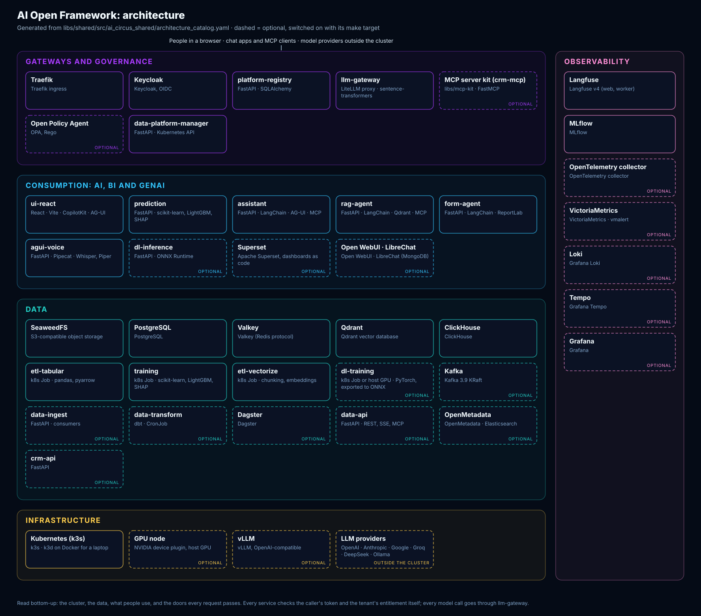

# Architecture guide

How the framework is built, for someone seeing it for the first time: the layers from the cluster up, one request
followed end to end, and how a YAML file becomes an app. Every component's one-line description, how to switch it on
and its design decisions are in [components.md](components.md); both pages and the diagram are generated from one
catalog, so they cannot disagree with each other or with the app's **Architecture** page.

<p align="center">
  
</p>

## Contents

- [Read it bottom-up](#read-it-bottom-up)
- [One request, end to end](#one-request-end-to-end)
- [How a scenario becomes an app](#how-a-scenario-becomes-an-app)
- [Security and tenancy on every hop](#security-and-tenancy-on-every-hop)
- [What runs by default, and what you switch on](#what-runs-by-default-and-what-you-switch-on)
- [Keeping this page true](#keeping-this-page-true)

## Read it bottom-up

**Infrastructure.** Everything runs on one Kubernetes cluster: k3s, or k3d inside Docker on a laptop
(`make k3s-all`). Each service is a stateless container with requests, limits, probes and a non-root user. An
optional GPU node serves local models (vLLM) and deep-learning training. The LLM providers are outside the cluster.

**Data.** Where data lives and how it gets there:

- *Stores*: SeaweedFS (S3-compatible: datasets, models, documents, every key prefixed by tenant), PostgreSQL
  (tenants, entitlements, chat history, monitors' metadata), Qdrant (one vector collection per scenario and tenant),
  Valkey (cache and counters) and ClickHouse (traces, analytical marts).
- *Batch jobs*, run once per scenario or on demand: `etl-tabular` cleans a dataset, `training` trains and selects the
  model, `etl-vectorize` indexes documents, `dl-training` fine-tunes deep-learning models.
- *The data platform* (optional, in tiers): Kafka, `data-ingest` (contracts, quarantine, bronze), `data-transform`
  (dbt, Dagster), `data-api` (the governed door) and OpenMetadata.

**Consumption: AI, BI and GenAI.** What people use. `ui-react` is the web app. Behind it, **one service per kind
of scenario** serves every scenario of that kind: `prediction` and `assistant` for tabular ML, `rag-agent` for
document Q&A, `form-agent` for assisted forms, `dl-inference` for deep learning. Superset draws BI dashboards;
Open WebUI or LibreChat are optional chat apps that reach the platform through MCP.

**Gateways and governance.** The doors every request passes: Traefik (the only ingress), Keycloak (sign-in; a
tenant is a Keycloak Organization), `platform-registry` (scenarios, entitlements, the audit trail, the AI-BOM) and
`llm-gateway` (LiteLLM: every model call and every MCP tool call, with routing, limits, per-tenant budgets and the
local embedding model). The MCP server kit puts an existing API behind the MCP gateway with its own token audience.
`data-platform-manager` is the admin control plane behind the Platform page.

**Observability**, alongside everything: Langfuse records a trace per LLM call, MLflow every training run; the
optional lab bundle adds an OpenTelemetry collector, VictoriaMetrics, Loki, Tempo and Grafana
([ADR 0015](../adr/0015-observability-platform-contract.md)).

## One request, end to end

A prediction in a model tab:

1. `ui-react` sends `POST /predict/{scenario}` with the user's token to `prediction.localhost`.
2. Traefik routes it to `prediction` by hostname.
3. `prediction` checks the token (signature, organization) and asks `platform-registry` whether this tenant may use
   this scenario. The answer is cached for 30 seconds; the UI's own filtering is never trusted.
4. The tenant's model was loaded from SeaweedFS at start-up (or the shared fallback model when the tenant has none),
   so the first prediction is instant.
5. The answer is the probability and the SHAP contribution of every input.

A question to the assistant follows the same first three steps, then the LLM, through `llm-gateway`, decides which
tool to call (`predict`, `explain`, a forecast, a data query); the assistant runs it and the LLM answers from the
result. `llm-gateway` checks the tenant's rate limit and budget, and sends a trace to Langfuse. Six such flows are
spelled out step by step in [components.md](components.md#request-flows), and the app animates them on its
Architecture page and on each scenario's Overview.

## How a scenario becomes an app

A scenario is one `scenarios/<slug>/scenario.yaml`, validated by `ai_circus_shared.scenario_schema`:

1. `platform-registry` seeds it at start-up and grants it to the admin tenant; other tenants get it through a
   Keycloak role.
2. The batch jobs read the same file as build-time config: `etl-tabular` the dataset, `training` the candidates.
3. The service of its kind serves it under its slug (`/predict/{slug}`, `/agui/{slug}`): no new code.
4. `ui-react` draws generic tabs from it (the feature schema becomes the inputs, `default_charts` the dashboard,
   `ui_extras` a showpiece tab, `story` the Overview and its guided demo).
5. `ai_circus_shared.architecture` derives from it which components the scenario uses and why, and the registry
   serves that with the scenario: its Overview shows the same map with its part lit.

## Security and tenancy on every hop

- **Every service checks for itself.** The token and the entitlement are checked by the service that answers, never
  only by the UI.
- **Every read is scoped by tenant**: object-store keys, Qdrant collections and database rows carry the tenant.
- **Every model call goes through `llm-gateway`**, embeddings included (a test enforces it), so limits, budgets,
  policy and traces apply to all of them.
- **MCP**: an external chat reaches a tool only through the MCP gateway with the user's own token; a kit server
  exchanges it for a token valid only for its API, and the API sees a pseudonym ([ADR 0022](../adr/0022-mcp-server-kit-and-per-api-tokens.md), [0029](../adr/0029-pseudonymous-users-at-the-apis.md)).
- **Logs and traces carry no content**: no prompts, no personal data; the collector masks tokens and emails.

## What runs by default, and what you switch on

`make k3s-all` starts the core: the gateways, the services of every scenario kind, the stores and the monitors.
Everything else is a switch, so a 16 GB laptop can run the part a demo needs: deep learning (`make k3s-dl-up`), the
data platform's tiers (`make k3s-data-core-up` and the others), the chat apps (`make k3s-chat-ui-up`,
`make k3s-librechat-up`), the MCP examples (`make k3s-mcp-examples-up`), vLLM (`make k3s-vllm-up`) and the
observability bundle (`make k3s-obs-up`). [components.md](components.md) gives the command for each component.

## Keeping this page true

The catalog is [`libs/shared/src/ai_circus_shared/architecture_catalog.yaml`](../../libs/shared/src/ai_circus_shared/architecture_catalog.yaml).
After adding or changing a component, edit it and run:

```bash
libs/shared/.venv/bin/python scripts/generate_architecture.py
```

It rewrites `architecture.svg`, `components.md` and the app's copy. The libs/shared tests fail when a workload under
`k8s/` or `observability/bundle/` is missing from the catalog, or when a generated file is out of date.
