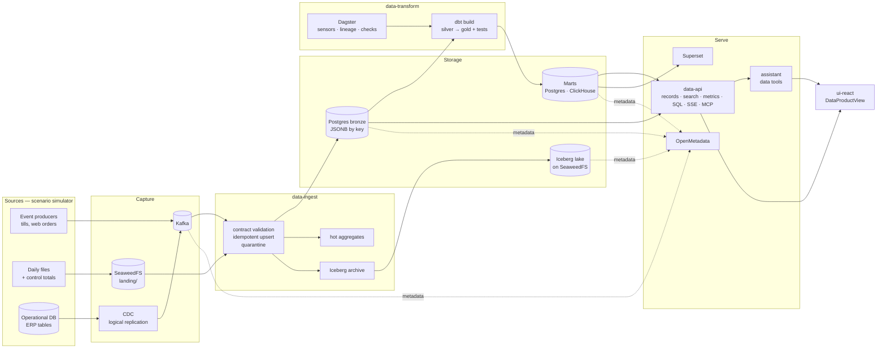

# Data Platform — an open-source, scenario-driven data platform tier

The Data Platform turns the framework from "AI on top of datasets" into "AI on top of a
governed data platform": events and files are captured, landed raw (bronze), transformed as
code into conformed tables (silver) and marts (gold), served through one governed API, the
assistant, BI dashboards and a metadata catalogue — all open source, all on the same k3s
cluster, all driven by a scenario of the new kind **`data_product`**.

It is a *platform capability*, not a retail feature: the services under `services/data-*`
contain no domain words. Everything specific to a data product — its contracts, simulator,
dbt project, metrics, access rules, dashboards — lives under `scenarios/<slug>/`.
`surf_retail` (Angel's Surf Co., a fictional chain of surf, SUP and kite shops invented by the author, a surf enthusiast) is the first data product: 24 shops, a web shop, an ERP and five years of history, with a storefront app, a control room (Surf HQ) and two models trained on its gold feature marts.

Design source: the "Retail Omnichannel Data Platform" proposal (v0.1, October 2026). The
decisions below adapt it to this repository; each one is an ADR under [`docs/adr/`](../adr/).

## Architecture



Cross-cutting, reused as-is: Keycloak (identity, tenant = Keycloak Organization),
platform-registry (scenarios + entitlements), llm-gateway (every LLM call), Langfuse (assistant
traces), data-platform-manager (admin Platform view), Traefik (ingress).

## Tiers — one cluster, switched on by layer

The whole data tier is optional and **off by default**: `make k3s-all` never starts it. Each
tier is a kustomize overlay under `k8s/data-platform/<tier>/` with its own `make` target, so a
16 GB laptop runs the layers a demo needs instead of all of them.

| Tier | Make target | Components | Capabilities shown |
|---|---|---|---|
| **core** | `k3s-data-core-up` | Kafka · `data-ingest` · `data-api` · `data-transform` (dbt as a Job) · Postgres bronze/silver/gold · Iceberg on SeaweedFS | Event capture, CDC, file landing + reconciliation, contracts, quarantine, lakehouse, transformations as code, data quality, governed API, row-level access, pseudonymisation, assistant over data, live flow |
| **analytics** | `k3s-data-analytics-up` | ClickHouse marts + hot path (shared ClickHouse instance, own database) · Dagster webserver + daemon | Columnar marts, second-level hot aggregates, orchestration with sensors, asset lineage and checks |
| **bi** | `k3s-data-bi-up` | Apache Superset | Dashboards versioned as code, role-scoped SQL access |
| **governance** | `k3s-data-governance-up` | OpenMetadata + OpenSearch (metadata ingestion as Jobs, no Airflow) | Catalogue, end-to-end lineage (topic → bronze → dbt → marts → dashboard), glossary, quality results, ownership |
| demo (no governance) | `k3s-data-demo` | core + analytics + bi with every scenario kind running; MLflow, voice and governance off | The usual multi-scenario demo including data; `k3s-data-demo-off` undoes it |
| everything | `k3s-data-showcase` | all four tiers, AI-only extras scaled to zero | The full storyline on one laptop |

`k3s-data-showcase` follows `k3s-demo`'s pattern: it frees memory by scaling to zero what a
data demo does not need (mlflow, agui-voice, dl-inference, Langfuse web/worker), then applies
every tier. `k3s-data-showcase-off` restores them.

## Capability map — what exists, what is new

Verified against `develop` at v0.30.2, before this tier landed (the proposal's §3.1 was an assumption list); the *Gap / change* column is what v0.31.0 added.

| Capability | Already in the repo | Gap / change |
|---|---|---|
| Object storage | SeaweedFS (`ai_circus_shared.storage`) | New bucket `ai-circus-data` (landing, lake) |
| Relational + document | Postgres 16, JSONB `document_store` | New database `data_platform`, a schema per data product |
| Event backbone | Kafka 3.9 KRaft (`k8s/data-platform/kafka.yaml`, `ai_circus_shared.events`) | Moved under the core tier (`core/kafka.yaml`); a topic per contract and tenant |
| CDC | Postgres logical replication, `ai_circus_shared.cdc` (test_decoding, polling) | Reused by `data-ingest` for the data product's operational tables |
| Lakehouse | PyIceberg SQL catalog on SeaweedFS (`data-platform-manager/core/lakehouse.py`) | `data-ingest`'s lake archiver: one Iceberg table per source, day-partitioned |
| Federation / semantic | DuckDB over Iceberg + Postgres (`data-platform-manager/core/semantic.py`) | Metrics become scenario-declared (`metrics:`), served by `data-api` |
| Analytical engine | ClickHouse 26.4 (Langfuse backend only) | Own `data_platform` database + user, analytics tier |
| Transformation | — | dbt-core project per data product (`scenarios/<slug>/dbt/`) |
| Orchestration | k8s Jobs triggered by data-platform-manager | Core: dbt Job/CronJob; analytics: Dagster |
| Contracts | Pydantic scenario schema only | JSON Schema contracts per source (`ai_circus_shared.contracts`) |
| Data quality | — | Record rules + quarantine at ingest; dbt tests; reconciliation |
| Catalogue + lineage | — | dbt docs (core), Dagster (analytics), OpenMetadata (governance) |
| BI | ui-react Data tab (Plotly) | Native live tab (core) + Superset (bi tier) |
| Data API | per-kind services | `data-api` (records, search, metrics, governed SQL, SSE, MCP) |
| Assistant over data | `assistant` (tabular_ml tools) | Data tools bound for `data_product` scenarios |
| Identity / tenancy | Keycloak orgs, `resolve_caller_identity`, entitlements | Row filters + column masks from roles/claims (`ai_circus_shared.data_policy`); token claims on `Identity.attributes` |
| Operations | data-platform-manager status/resources/workloads/roadmap | Rows for the new components; data tiers in `OPTIONAL_SERVICES` |
| Scenario kind | 4 kinds | 5th kind `data_product` |

## Runbook

```bash
make k3s-data-build                 # images: data-ingest, data-api, data-transform
make k3s-data-core-up               # Kafka + data-ingest + data-api + the dbt CronJob
make k3s-data-seed                  # the scenario's history (five years for surf_retail) through the real pipeline
make k3s-data-seed-lite             # one year, for laptops short of memory or disk
make k3s-data-ml                    # train the tabular_ml scenarios the data product exports
make k3s-data-transform             # a dbt build now (the CronJob runs every 3 minutes)
make k3s-data-analytics-up          # Dagster + ClickHouse marts (data-api reads ClickHouse)
make k3s-data-bi-up                 # Superset + dashboards as code
make k3s-data-governance-up         # OpenMetadata + catalogue sync
make k3s-data-showcase              # all of the above, AI-only pods scaled to 0
make k3s-data-call P=/v1/surf_retail/overview   # any data-api GET as the admin
make k3s-data-reset                 # drop every byte of one data product, then re-seed
```

Each `*-up` has a `*-down`. Open http://aiopen.localhost → *Angel's Surf Co. — Data
Platform*. Its first tab is the **Guided tour** (`ui-react/src/DataTourView.tsx`, content in
`dataTour.ts`): a live map of the whole platform that lights up with real pipeline events, and
eleven steps — sources, capture, contract gate, bronze, live tile, lake, transform, gold,
serving doors, governance, the capability map — each at three depths (*Simple* for anyone,
*Detailed* with the components, *Engineer* with alternatives, contracts, SQL and live JSON),
with live numbers from the cluster and a *try it* button that does the real thing (ring up a
sale, send a broken receipt, re-send a duplicate, view as a store manager, ask the assistant).
Press play for a hands-free demo. The other tabs: Data product · Live flow (simulate sales, bad records, legacy files, price changes)
· Dashboards · Explore (records, datasets, governed SQL, quarantine) · Quality & lineage. The
admin can *view as* any role (analyst, store manager S012, data steward) and the assistant
answers within that role. Tool UIs: http://dagster.localhost (admin basic auth),
http://superset.localhost (`admin` / `SUPERSET_ADMIN_PASSWORD`),
http://openmetadata.localhost (`admin@open-metadata.org`, OpenMetadata's default password).

## How a data product is declared

```text
scenarios/<slug>/
  scenario.yaml        # kind: data_product — sources, bronze, transform, metrics, access, serving, ui
  contracts/           # JSON Schema of every event / file
  simulator/           # deterministic generator (backfill + live + anomalies), plugin API below
  dbt/                 # silver/gold models + tests (targets: postgres, clickhouse, duckdb)
  bi/dashboards.yaml   # Superset dashboards as code (bi tier)
```

`scenario.yaml`'s `data_product` block (schema: `ai_circus_shared.data_product`) declares
sources (kafka topics with JSON Schema contracts and record rules, file deliveries with their
control files, CDC tables), the hot-path aggregates, the curated datasets with freshness SLOs,
the governed metrics, record entities, access roles (row filter, hidden fields, layers, SQL),
simulator actions, the native dashboard's KPIs and panels, and the stage labels of the live
flow.

Adding a data product is those files plus a `platform-registry` restart — no new service or UI
code. If a second data product ever needs a change inside `services/data-*`, that change must be
generic (it is a bug in the platform, not a feature of the scenario).

## Memory budget (measured on the reference laptop, WSL2 with 11 GiB)

Base framework when measured (v0.30.2, all 17 pods): **≈ 5.9 GiB** working set, node ≈ 7.2 GiB.
Per-tier numbers are filled in by each milestone's verification (`kubectl top`, peak under the
demo storyline), never copied from the proposal's estimates.

| Tier | Limits (sum) | Measured | Notes |
|---|---|---|---|
| core | 2.0 GiB (+ 768 MiB transform Job) | ≈ 0.8 GiB | kafka 460 MiB, data-ingest 190 MiB, data-api 140 MiB; the CronJob is suspended while Dagster owns transforms |
| analytics | 2.1 GiB | ≈ 1.5 GiB | Dagster daemon ≈ 1.06 GiB right after a dbt build (limit 1.5 GiB), webserver ≈ 420 MiB; ClickHouse is the shared Langfuse instance (178 MiB with the marts loaded) |
| bi | 1 GiB | ≈ 0.2 GiB | Superset idle, three dashboards synced |
| governance | 2 GiB (+ 1 GiB sync Job) | ≈ 1.8 GiB | OpenMetadata 845 MiB, om-search (Elasticsearch) 960 MiB; the heaviest tier — switch it on for the catalogue part of the demo |

Measured on 29 Oct 2026 with every tier up and the AI-only pods (langfuse web, mlflow,
agui-voice, prediction, rag-agent, form-agent, qdrant) scaled to 0: node ≈ 9.2 GiB used of 11.7.

Re-checked on 30 Oct 2026 (v0.33.1, after the governance-ready releases) with every tier up and prediction + assistant
running (rag-agent, form-agent, qdrant, langfuse, mlflow, agui-voice at 0): core ≈ 0.77 GiB (kafka 465 MiB,
data-ingest 153, data-api 150), analytics ≈ 1.3 GiB (Dagster 1.16 GiB, both containers; ClickHouse 159 MiB), bi ≈ 0.23 GiB, governance ≈ 1.8 GiB (OpenMetadata 829 MiB, om-search 966 MiB); node 8.7 GiB used of 11.7
(74%).
The images of the AI services (llm-gateway, prediction, …) were not rebuilt for this check, so it says nothing about the memory cost of the v0.32–v0.33 governance code in them.

## Milestones

| | Scope | Done when |
|---|---|---|
| M0 | This document, ADRs, `data_product` kind in the schema + registry | Schema tests green; registry seeds the kind |
| M1 | Contracts, retail simulator, topics/buckets/databases bootstrap | Simulator backfill + live produce valid messages |
| M2 | `data-ingest` (stream, batch + reconciliation, CDC, quarantine, archive, hot aggregates) | Replay keeps counts; bad record quarantined; legacy gap flagged |
| M3 | dbt project (staging, SCD2 dims, facts, marts, tests) + `data-transform` Job; `data-api` | `dbt build` green on DuckDB and Postgres; receipt reaches gold |
| M4 | Analytics tier: ClickHouse marts + hot path, Dagster | Same marts on ClickHouse; sensor-driven runs |
| M5 | BI tier: Superset with dashboards as code | Dashboards imported by `make` |
| M6 | Governance tier: OpenMetadata + ingestion Jobs | Lineage topic → dashboard visible |
| M7 | ui-react DataProductView (live flow, simulate, explore) + assistant data tools | Storyline runs from the browser |
| M8 | Hardening: verify targets, limits tuned, docs, screenshots | Clean cluster → demo in one documented sequence |
