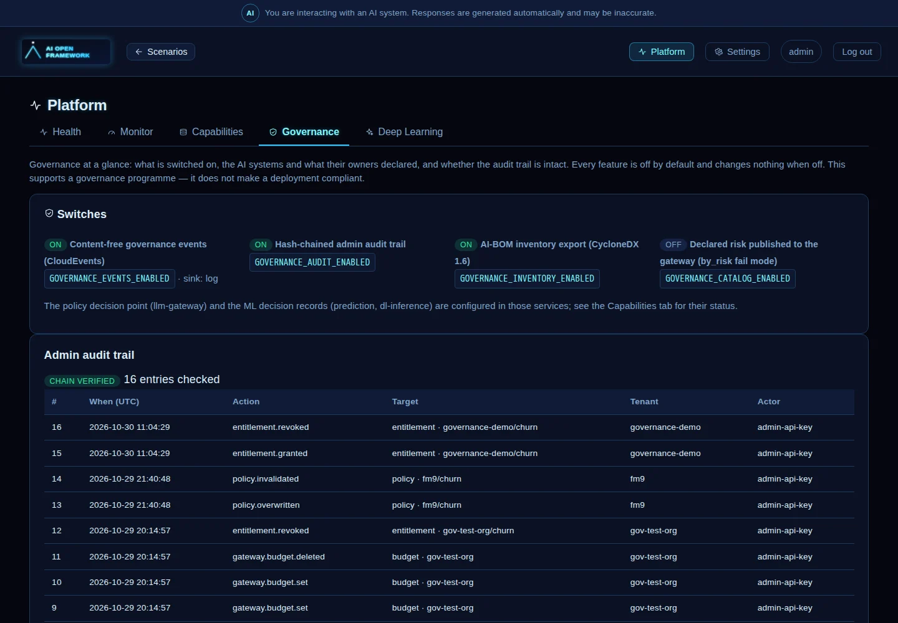

# Governance-ready by standards

The framework is **governable by an external AI-governance tool without depending on any product**. It
exposes what a governance programme needs through open contracts — JSON Schema, CloudEvents, OpenTelemetry,
CycloneDX, OPA-compatible JSON — and enforces the decisions a tool sends back. Design rules and the reasoning:
[ADR 0011](../adr/0011-governance-ready-by-standards.md).

**The admin dashboard.** *Platform → Governance* shows the switches below, the AI systems with what their owners declared (risk
category, human oversight), the audit trail with a chain-verified badge and the latest changes, and an AI-BOM download. It
answers while every feature is off. API: `GET /governance/overview` on platform-registry (admin only, read-only, content-free).
The policy decision point and the ML decision records are configured in other services and are not on the dashboard yet.

## What this is, and is not

| It provides | It does not provide |
|---|---|
| Declared metadata for every AI system, with a stable `ai_system_id` | A governance product, a GRC or AIMS interface, or a risk-assessment workflow |
| An inventory export (CycloneDX AI-BOM) | Automatic legal classification — risk categories are **declared by the owner**, never inferred |
| Trace attributes, decision records and events carrying ids, metrics and decisions | Compliance. It *supports* an ISO/IEC 42001 / EU AI Act management system and *provides evidence for* it; it is not one |
| A pluggable policy decision point enforced at the single model chokepoint | Prompt or personal-data capture in governance data (events, audit and records are content-free) |
| A tamper-evident admin audit trail | Integration with any particular vendor (none is named in code, config or docs) |

Everything is **off by default**. With every switch off the platform behaves exactly as it did before.

## Plugging in an external tool

Three contracts carry decisions and evidence in each direction, plus one export.

| Direction | Contract | Doc | Schema |
|---|---|---|---|
| tool → gateway (decide) | **Policy decision**: the gateway asks `{tenant_id, ai_system_id, model, call_type}`, enforces `{decision, reason_code, obligations}` | [policy.md](policy.md) | [policy-input](schemas/policy-input.json), [policy-decision](schemas/policy-decision.json) |
| tool → gateway (change) | **Invalidation webhook**: `POST /governance/policy/invalidate`, HMAC-signed — clears or replaces a cached decision (e.g. suspend an AI system) | [policy.md](policy.md#caching-and-change-notification) | – |
| platform → tool | **Events**: CloudEvents 1.0 over a log line or an HMAC-signed webhook with a retrying outbox | [events-and-audit.md](events-and-audit.md) | [envelope](schemas/cloudevent-envelope.json) + one per event |
| platform → tool | **Inventory**: CycloneDX 1.6 AI-BOM, `GET /governance/inventory` | [inventory.md](inventory.md) | the official CycloneDX schema |

Also available to a tool: the hash-chained admin audit trail (`GET /governance/audit`, `/audit/verify`) and
the trace attributes on every model call ([telemetry.md](telemetry.md)).

A typical wiring: set `POLICY_DECIDER=http` and `POLICY_HTTP_URL` to the tool's decision endpoint, give it the
invalidation secret, point `GOVERNANCE_WEBHOOK_URL` at its event receiver, and let it read the AI-BOM.

## The switches

| Variable | Default | Effect |
|---|---|---|
| `POLICY_DECIDER` | `noop` | `static`, `opa` or `http` enables enforcement at llm-gateway |
| `POLICY_FAIL_MODE` | `open` | `closed`, or `by_risk` (closed only for high-risk systems) when the decision point is down |
| `GOVERNANCE_EVENTS_ENABLED` | `false` | emit events (`GOVERNANCE_EVENT_SINK=log\|http`, `GOVERNANCE_WEBHOOK_URL`, `GOVERNANCE_WEBHOOK_SECRET`) |
| `GOVERNANCE_AUDIT_ENABLED` | `false` | hash-chained admin audit trail |
| `GOVERNANCE_POLICY_HMAC_SECRET` | – | enables the invalidation webhook |
| `GOVERNANCE_CATALOG_ENABLED` | `false` | publish declared risk to Valkey for `POLICY_FAIL_MODE=by_risk` |
| `GOVERNANCE_INVENTORY_ENABLED` | `false` | serve the AI-BOM |
| `GOVERNANCE_RECORD_STORE` / `GOVERNANCE_RETENTION_DAYS` | off / `183` | keep non-LLM decision records, and for how long |
| `TRACE_CAPTURE_CONTENT` | `true` | `false` redacts prompts and completions from traces |

## Declaring an AI system

Add an optional `governance:` block to a `scenario.yaml` ([schema](schemas/ai-system-governance.json); three
scenarios carry illustrative examples, marked "owner to confirm"). Without it a scenario still gets its slug as
`ai_system_id`. Risk stays `unassessed` until a person sets it.

## Crosswalk

How the capabilities **support** the frameworks named below. This is an engineering mapping to help a
compliance team find evidence; it is not legal advice, and it has not been reviewed by a lawyer or an
auditor — have someone qualified confirm it before relying on it.

| Capability | EU AI Act (supports) | ISO/IEC 42001 | NIST AI RMF |
|---|---|---|---|
| AI system metadata + AI-BOM | Art. 11 / Annex IV (partial), Art. 49 (input) | A.4, A.6, A.7 | Map |
| Traces + decision records + retention | Art. 12, Art. 19, Art. 26(6) | 9.1, A.6 | Measure |
| Policy decision + enforcement | Art. 9 (risk controls), Art. 14 (oversight effect) | 8.1, A.9 | Manage |
| Governance events | Art. 72 (post-market monitoring input), Art. 73 (incident input) | 9.1, 10 | Manage |
| Admin audit trail | Art. 12 (supporting) | 7.5 (documented information) | Govern |

"Partial" and "input" mean the framework produces material for that obligation, not that it satisfies it.

## Known limits

- **Admin identity.** The admin API is a shared bearer key, so the audit trail records the credential class
  (`admin-api-key`), not a named person.
- **Audit anchoring.** The hash chain proves rows were not altered by someone who cannot recompute it; keep the
  `audit_hash` carried in events outside the system to detect a rewritten chain or a truncated tail.
- **Ungoverned calls.** A model call with no tenant or AI system attached (internal admin tests) is not
  subject to policy. Speech vendors used by agui-voice are outside the model chokepoint.
- **Trace retention** is Langfuse's to configure; **event retention** is the sink's.
- **Not covered yet:** per-AI-system tool scoping and agent step limits (the `obligations` object can grow
  `allowed_tools` / `max_steps`), and the SPDX 3.0 AI profile as a second inventory format.

## Verifying it works

Each capability has unit tests and a documented live check; `make check-all` covers the lot. The contract
tests fail if a published schema drifts from its model, if a service bypasses llm-gateway, or if the telemetry
doc stops listing an attribute.
