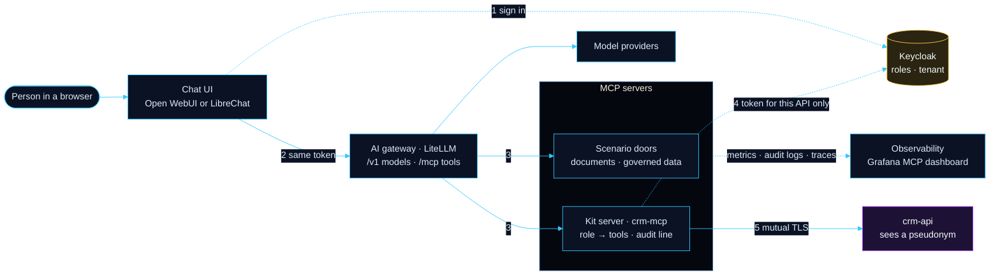
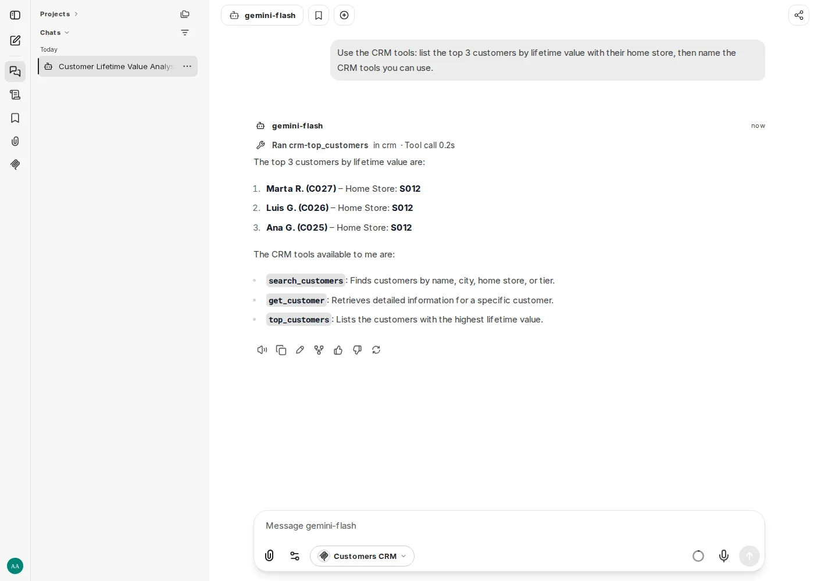
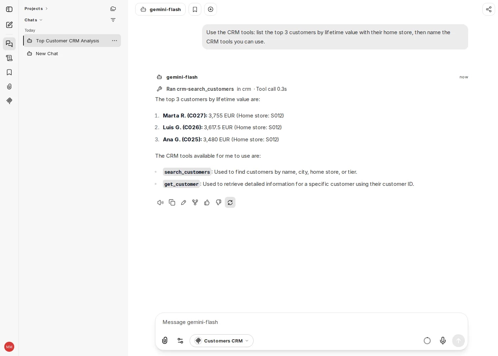
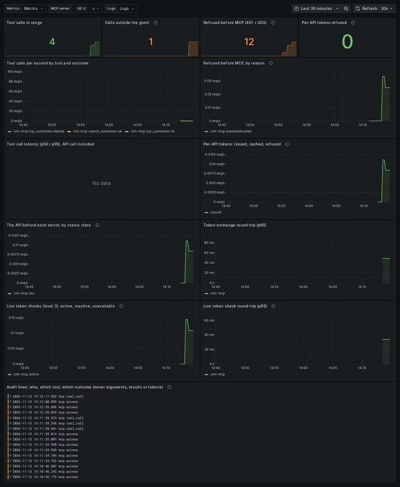

# MCP Lite Stack — governed tools for chat UIs

A chat UI where each person signs in with Keycloak and uses MCP tools as themselves: every MCP server sees the
signed-in user's own token, lists only the tools that user's role is granted, and calls its API with a token valid for
that API alone. One file, [`mcp/catalog.yaml`](../../mcp/catalog.yaml), decides which servers exist and who may run
what. Everything here is optional and off by default; the AI gateway is open-source LiteLLM only.

It runs inside the full framework, or alone as the **MCP lite profile** (`make k3s-mcp-lite`, about 3 GB), which
proves it needs nothing else of the framework. Each decision below is an ADR under [`docs/adr/`](../adr/), 0019 to 0029.

## Architecture



1. **Sign in.** Keycloak checks the password and issues a token carrying the person's realm roles and tenant
   (Keycloak Organization). Neither chat UI has local accounts.
2. **Ask.** The chat UI sends that same token to the gateway, one connection per MCP server, so one
   `Authorization` header only ever reaches one server.
3. **Filter.** The server checks the token and lists only what the role is granted. A scenario door asks the
   platform-registry for the tenant's entitlement and applies the scenario's own role rules; a kit server applies the
   catalog's grants. Every call writes an audit line.
4. **Exchange.** A kit server trades the user's token at Keycloak for one valid only at its API (RFC 8693). At
   Level 3 that token is bound to a key the server holds in memory (DPoP) and both tokens are checked live.
5. **Answer.** The API applies its own rules (here: only the shops that person may see) and sees the user under a
   pseudonym of its own, never the Keycloak id.

## The pieces

| Piece | What it does | Where | ADR |
|---|---|---|---|
| Scenario doors | A scenario's own read-only MCP door: documents (`rag-agent`) or governed data (`data-api`), under the existing entitlements | `mcp:` in `scenario.yaml` | [0019](../adr/0019-mcp-doors-and-tool-policy.md) |
| AI gateway | `llm-gateway` is also the MCP gateway: `/mcp/<server>`, every route `true_passthrough` (the caller's token goes through, the server decides); forwards the caller's trace context, never baggage | `services/llm-gateway/litellm_config.yaml` (generated block) | [0020](../adr/0020-mcp-gateway-without-enterprise.md), [0028](../adr/0028-masked-logs-and-one-trace-through-the-mcp-hop.md) |
| Chat UIs | Open WebUI (`chat.localhost`) and LibreChat (`librechat.localhost`, MIT): Keycloak-only sign-in, each user's token to every server | `k8s/chat-ui/`, `k8s/chat-ui-librechat/` | [0021](../adr/0021-chat-ui-with-real-keycloak-sign-in.md), [0026](../adr/0026-librechat-second-chat-ui.md) |
| MCP server kit | `libs/mcp-kit`: token validation, the access policy, the per-API exchange, audit lines; a server's own code is its tools only. Example: `crm-mcp` in front of `crm-api` | `libs/mcp-kit/`, `services/crm-mcp/`, `services/crm-api/` | [0022](../adr/0022-mcp-server-kit-and-per-api-tokens.md) |
| Observability | `mcp_kit_*` metrics, audit lines with trace ids, one trace from the chat UI to the API; the collector masks tokens and emails in every stored log line | `observability/` (`make k3s-obs-up`) | [0023](../adr/0023-observability-of-the-mcp-path.md), [0028](../adr/0028-masked-logs-and-one-trace-through-the-mcp-hop.md) |
| Catalog | One file for servers and grants; a generator writes the gateway routes, both chat UIs' connections, each kit server's `policy.yaml` and the Keycloak clients; CI fails on drift; an optional local portal edits it | `mcp/catalog.yaml`, `scripts/generate_mcp_catalog.py` | [0024](../adr/0024-one-mcp-catalog.md) |
| Level 3 | For regulated servers: DPoP-bound per-API tokens, live token checks, mutual TLS to the API with one CA per pair | `level: 3` in the catalog | [0025](../adr/0025-level-3-regulated-mcp-servers.md) |
| Lite profile | The stack alone on its own k3d cluster, from the framework's own manifests, with a check that needs no model | `k8s/mcp-lite/`, `scripts/k3s_mcp_lite.sh` | [0027](../adr/0027-mcp-lite-profile.md) |
| Pseudonyms | Each API sees Keycloak's pairwise pseudonym of the user; an identity admin can map it back for an audit | generated Keycloak mapper, `scripts/mcp_pseudonym.py` | [0029](../adr/0029-pseudonymous-users-at-the-apis.md) |

### Security levels

| Level | Token at the server | Token at the API | Use |
|---|---|---|---|
| Door | the user's own (the door is the API) | — | a scenario's documents or governed data |
| 2 (default kit server) | the user's own, validated by signature | exchanged for this API only, minutes long | an MCP server in front of an existing API |
| 3 (regulated) | the user's own, also checked live at Keycloak | exchanged, DPoP-bound, checked live; mutual TLS | banking, insurance, health |

### Who sees which identity

| Where | Sees the user as |
|---|---|
| Chat UI, AI gateway, MCP servers' audit lines | the Keycloak id (chat accounts are bound to it; the audit trail is the platform's own record) |
| Each API behind a kit server | its own stable pseudonym; two APIs cannot join their logs |
| Stored logs | never an email address or a token: the collector masks them, third-party lines included |

## Run it

The demo tenant `lite-demo` has two users, `analyst@lite-demo.local` (all CRM tools, every shop) and
`manager@lite-demo.local` (store S012: no `top_customers`). Their password is `CHAT_UI_DEMO_PASSWORD` in `.env`,
generated with every other key by the identity step that each target below runs.

**In the full framework** (k3s):

```bash
make k3s-mcp-examples-up     # crm-mcp + crm-api, Level 3
make k3s-librechat-up        # or: make k3s-chat-ui-up (Open WebUI); one chat UI at a time on 16 GB
make k3s-obs-up              # optional: metrics, logs, traces, Grafana at grafana.localhost
```

Open `http://librechat.localhost`, sign in, pick **Customers CRM** under **MCP Servers** and ask for the top
customers: the analyst's answer runs `top_customers`, the store manager's cannot. MCP clients on this machine can use
the doors and the gateway directly with `make k3s-mcp-portforward` (`:8031`, `:8032`, gateway `:8033`).

**Alone, as the lite profile** (its own k3d cluster; pause the framework's first, both use port 80):

```bash
make k3s-pause
make k3s-mcp-lite                    # CHAT_UI=librechat for LibreChat; OBS=1 adds observability
make k3s-mcp-lite-verify             # sign-ins, grants, a granted and a refused call; with OBS=1 also the signals
make k3s-mcp-lite-down && make k3s-resume
```

`make k3s-mcp-lite-verify` needs no model: each demo user signs in through Keycloak's own login pages, then every
kit server's tools are listed and called through the gateway with that user's token and compared with the catalog.
With `OBS=1` it also finds the calls' metrics, audit lines and traces, follows a trace it sent through the gateway into
the server and its API, and fails if any stored log line carries a token or an email address.

<p align="center">
  
  
</p>

## Add an API

1. Scaffold the MCP server: `make new-service NAME=<api>-mcp`, add `mcp-kit` as a dependency and write its tools
   with `@kit.tool()` (the kit does tokens, policy, exchange and audit). The API itself only has to accept a token
   whose audience is its own client.
2. Add a `kit_server` entry to `mcp/catalog.yaml` (service, API, tools, optional tenants and `level: 3`) and grant
   tools to groups (realm roles). `make mcp-catalog-portal` does the same in a local page.
3. `make mcp-catalog` regenerates the gateway route, both chat UIs' connections, the server's `policy.yaml` and the
   Keycloak clients (exchange client, audience scope, pseudonym mapper); commit them together.
4. `make k3s-mcp-catalog-apply` puts it on the running cluster (`make k3s-mcp-tls` first at Level 3).

## Operate it

| Task | Command |
|---|---|
| Who may run what | `make mcp-catalog` prints the matrix after writing |
| Catalog drift (what CI runs) | `make mcp-catalog-check` |
| Renew Level 3 certificates (every 90 days) | `make k3s-mcp-tls`, then restart the pair |
| Which pseudonym an API sees for a user | `make k3s-mcp-pseudonym WHO=<username>` |
| Who a pseudonym from an API's log is | `make k3s-mcp-pseudonym FIND=<pseudonym>` (Keycloak admin access) |
| The MCP dashboard | Grafana → "AI Circus · MCP servers": calls, refusals, per-API tokens, live checks, audit lines |

<p align="center"></p>

## Known limits

- **LibreChat needs an https identity provider.** The lab's Keycloak is http, so a small lab-only load hook turns on
  the OpenID library's own opt-out (`k8s/chat-ui-librechat/oidc-allow-http.mjs`). Delete it with an https provider.
- **LibreChat refuses one call after a token refresh.** The gateway binds an MCP session to the token that opened it;
  LibreChat reopens the connection and the model retries. Idle connections close after 5 minutes to keep it rare.
- **Open WebUI sends no trace context** with its MCP calls, so its hop into a server is matched through the audit
  lines; LibreChat's is one trace.
- **Every user sees every server** in the chat UIs; the server refuses what the role is not granted. Per-group
  visibility would tie the framework to each chat UI's internal database.
- **Chat UIs keep the real user id.** Pseudonyms there would need every chat account moved to the new id.
