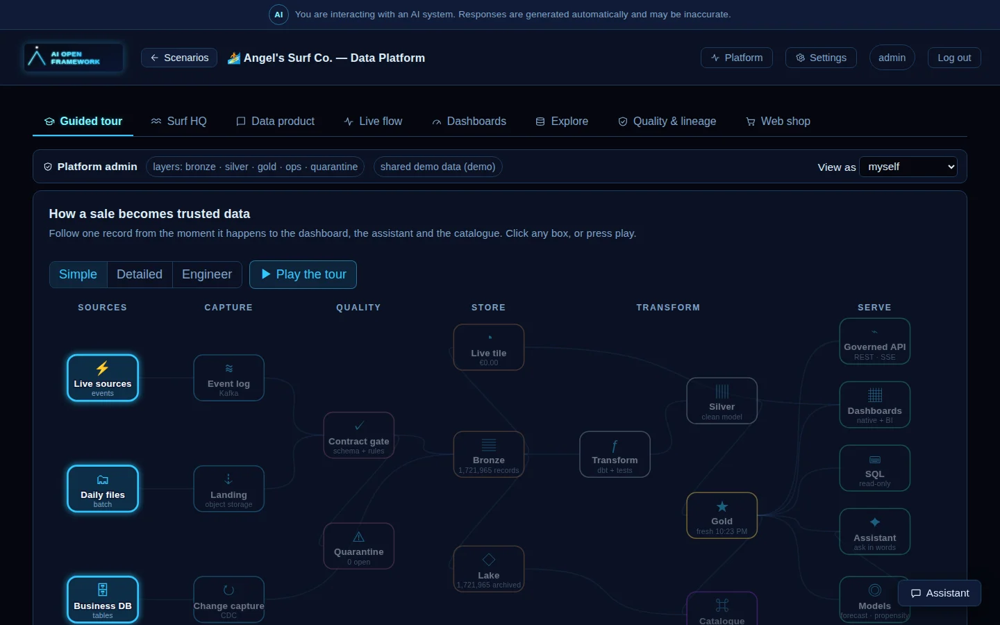
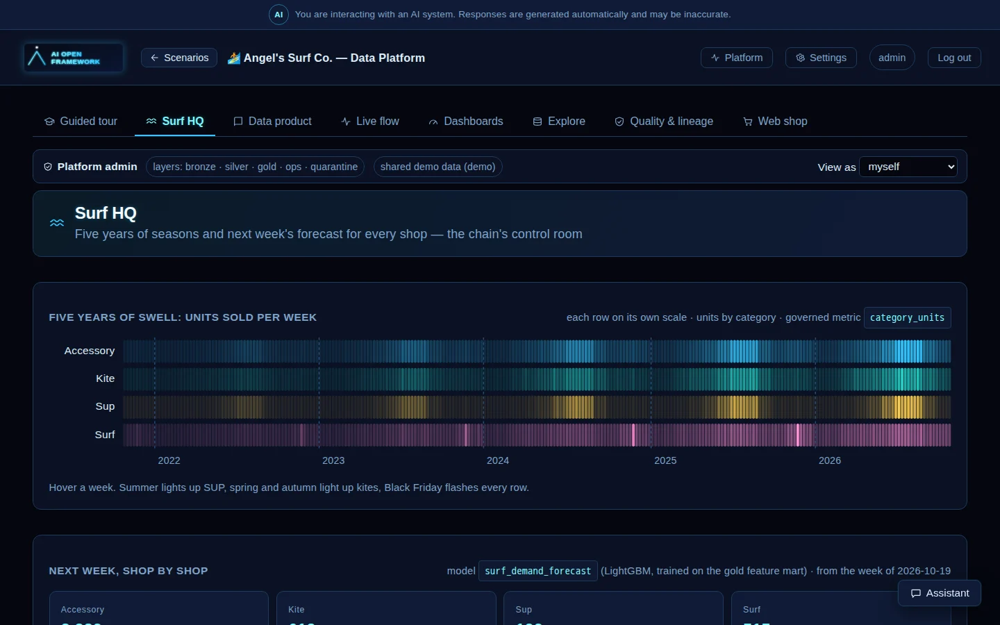
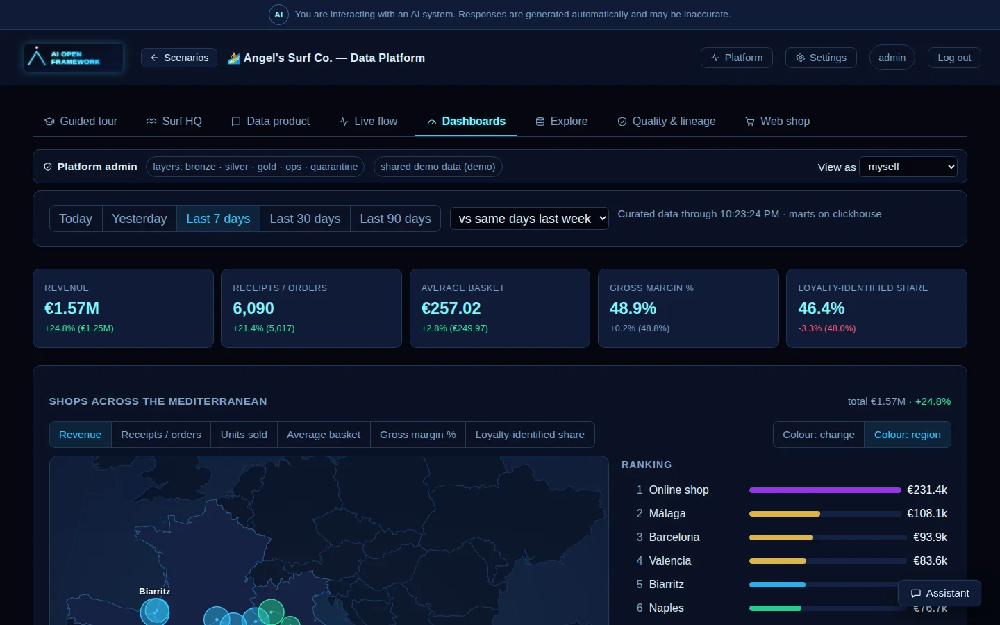
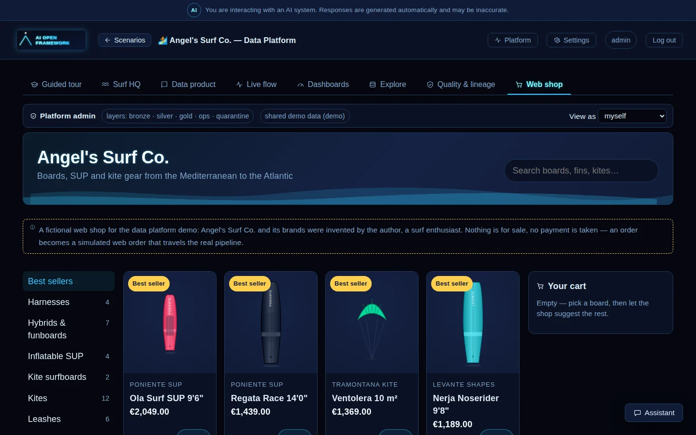

# 🏄 Angel's Surf Co. — a governed data platform (`data_product`)

> Domain: **Retail** · Kind: `data_product` (the fifth scenario kind) · Scenario: [`scenarios/surf_retail/scenario.yaml`](../../scenarios/surf_retail/scenario.yaml) · Child ML scenarios: [`surf_demand_forecast`](../../scenarios/surf_demand_forecast/scenario.yaml), [`surf_customer_propensity`](../../scenarios/surf_customer_propensity/scenario.yaml)

<p align="center">
  
</p>

**Why.** Most AI demos start from a CSV. A real company starts from tills, a web shop, an ERP and
daily files from a franchise whose old systems nobody dares to touch — and the hard part is
making all of that *trustworthy* before any model or dashboard sees it. This scenario runs a whole
data platform end to end, with open-source parts only, so the path from "a sale is rung up" to
"the assistant quotes a number" can be watched, broken on purpose and audited.

**The company is fictional.** Angel's Surf Co., its shops, brands and every sale were invented by
the framework's author, a surf enthusiast. All data comes from the scenario's own simulator;
nothing is for sale and no payment is taken.

| | |
|---|---|
| **Business** | 24 shops on the coasts of Spain, France, Italy, Greece, Cyprus and Malta, a web shop, an ERP, and five years of history |
| **Sources** | Till receipts and web orders **streamed through Kafka** (a topic per tenant); the Greek franchise's legacy tills send **daily files** reconciled against control totals; five years of history arrive as **migration files**; the ERP is captured by **change data capture** |
| **Pipeline** | contract check + business rules → quarantine · idempotent bronze (JSONB by key) → Iceberg lake → dbt silver (clean, pseudonymised) → gold marts, with tests → one governed API |
| **Serving** | `data-api` (metrics, records with their processing trail, governed SQL, lineage, live SSE), the assistant's data tools, native dashboards, Superset, OpenMetadata |
| **Access** | Tenant = Keycloak Organization on every door, then a role's row filters and column masks — *view as* a store manager and the API, SQL, dashboards and the assistant all show only that store |

## The workspace

| Tab | What it shows |
|---|---|
| **Guided tour** | The platform as a live map: eleven steps, each at three depths (*Simple*, *Detailed*, *Engineer*), with live numbers and a *try it* button that does the real thing — ring up a sale, send a malformed receipt, re-send a duplicate, view as a store manager, ask the assistant |
| **Surf HQ** | Five years of seasons as a heatmap (summer lights up SUP, spring and autumn light up kites, Black Friday flashes every row) and next week's forecast, shop by shop, from `surf_demand_forecast` |
| **Data product** | The product's overview: domain, number of sources, curated datasets and governed metrics, today's live tiles, and the four platform tiers with whether each is on |
| **Live flow** | Per-minute live tiles, the path every record takes (till / web shop / migration → Kafka → contract + rules → bronze → live tile → Iceberg lake → dbt → gold marts → API · BI · assistant), pipeline events, and controls to simulate sales, malformed receipts, legacy files with a missing receipt and ERP price changes |
| **Dashboards** | Governed KPIs, map and ranking of the shops, period and comparison pickers, all from the same metrics every other door uses |
| **Explore** | Records with their processing trail, datasets, SQL, quarantine |
| **Quality & lineage** | Freshness of each silver and gold table against its SLO, the last dbt test run, open quarantine, file-delivery reconciliation, and lineage |
| **Web shop** | A fictional storefront with a recommender (association rules over every basket); checkout is a hidden simulator action, so an order becomes a real web order travelling the real pipeline |

<table>
<tr>
<td width="50%" valign="top"></td>
<td width="50%" valign="top"></td>
</tr>
<tr>
<td colspan="2" valign="top"></td>
</tr>
</table>

## Two models on the gold marts

A gold **feature mart** is exported by `data-transform` after each Postgres build as the raw CSV of
an ordinary `tabular_ml` scenario (`ml_exports`), so the models are trained by the same
`etl-tabular` → `training` pipeline as every other scenario — `make k3s-data-ml` once a transform
has run.

| Scenario | Task | Predicts |
|---|---|---|
| `surf_demand_forecast` | LightGBM regression | Units sold next week per shop and category: season, recent weeks, the same week last year; explained with SHAP |
| `surf_customer_propensity` | LightGBM classification | Whether a loyalty customer buys a board in the next 90 days: recency, frequency, spend; customers are pseudonymised keys only |

The assistant calls them through its `ml_predict` tool, next to its governed data and catalogue
tools — it never estimates a figure the tools did not return.

## How it is built

- **Generic services, scenario-specific content.** `data-ingest`, `data-transform` and `data-api`
  contain no retail words. Everything specific lives in `scenarios/surf_retail/`: JSON Schema
  `contracts/`, a `simulator/` plugin, a `dbt/` project, `bi/dashboards.yaml` and the
  `data_product` block of `scenario.yaml`.
- **Switchable tiers**, never part of `make k3s-all`: core (Kafka, ingest, transform, API) ·
  analytics (ClickHouse, Dagster) · bi (Superset) · governance (OpenMetadata).
- Design, capability map and runbook: [docs/data-platform](../data-platform/README.md) and the
  [ADRs](../adr/README.md). Access policy and governance-ready contracts:
  [docs/governance](../governance/README.md).

## Run it yourself

```bash
make k3s-data-core-up        # Kafka + data-ingest + data-api + the dbt CronJob
make k3s-data-seed           # the history, through the real pipeline (k3s-data-seed-lite loads one year)
make k3s-data-transform      # a dbt build now
make k3s-data-ml             # train the two models on the feature marts
make k3s-data-showcase       # all four tiers on a 16 GB laptop (AI-only pods scaled to 0)
```

Then open http://aiopen.localhost → *Angel's Surf Co. — Data Platform*.
