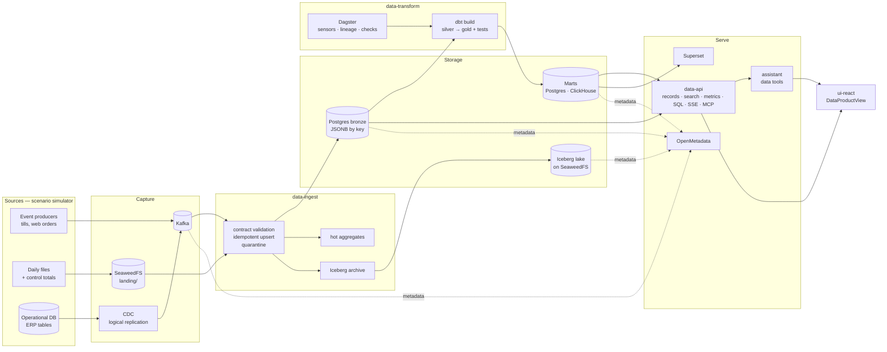

# Data Platform — an open-source, scenario-driven data platform tier - Architecture

Source: docs/data-platform/README.md (this repository)

Cross-cutting, reused as-is: Keycloak (identity, tenant = Keycloak Organization),
platform-registry (scenarios + entitlements), llm-gateway (every LLM call), Langfuse (assistant
traces), data-platform-manager (admin Platform view), Traefik (ingress).
