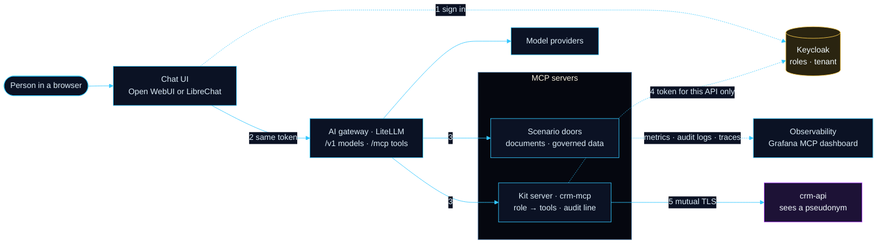

# MCP Lite Stack - Architecture

Source: docs/mcp/README.md (this repository)

1. **Sign in.** Keycloak checks the password and issues a token carrying the person's realm roles and tenant
   (Keycloak Organization). Neither chat UI has local accounts.
2. **Ask.** The chat UI sends that same token to the gateway, one connection per MCP server, so one
   `Authorization` header only ever reaches one server.
3. **Filter.** The server checks the token and lists only what the role is granted. A scenario door asks the
   platform-registry for the tenant's entitlement and applies the scenario's own role rules; a kit server applies the
   catalog's grants. Every call writes an audit line.
4. **Exchange.** A kit server trades the user's token at Keycloak for one valid only at its API (RFC 8693). At
   Level 3 that token is bound to a key the server holds in memory (DPoP) and both tokens are checked live.
5. **Answer.** The API applies its own rules (here: only the shops that person may see) and sees the user under a
   pseudonym of its own, never the Keycloak id.

### Services and ports

What `make k3s-mcp-lite OBS=1` runs (the same services run in the full framework), with each Kubernetes service's
port: one chat UI at a time, Open WebUI or LibreChat with its MongoDB.

